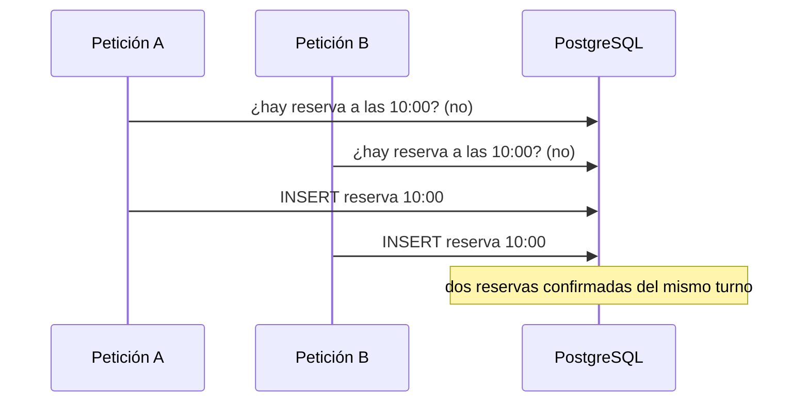
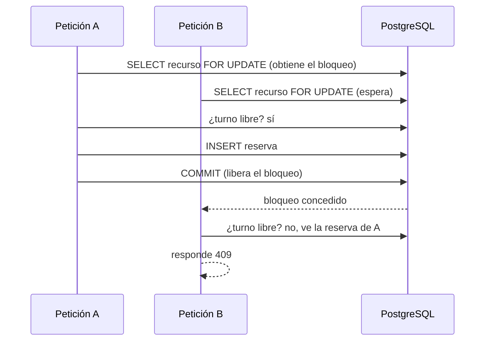

# Estrategia de concurrencia de las reservas

Este documento explica cómo evito las dobles reservas, qué alternativas consideré y qué medí para decidir. Todo lo que aparece como «medido» lo obtuve ejecutando las pruebas de este repositorio.

## El problema

Dos clientes piden el mismo turno casi al mismo tiempo. El código ingenuo comprueba si el turno está libre y luego inserta:



Es una condición de carrera del tipo *comprobar y luego actuar*. Cada petición, vista sola, hace todo bien. El fallo está en el hueco entre la comprobación y la escritura. Un `if` en Java no lo evita, y `@Transactional` tampoco: PostgreSQL usa por defecto el aislamiento `READ COMMITTED`, en el que cada sentencia ve solo lo que ya está confirmado, así que ninguna transacción ve la inserción pendiente de la otra.

## Qué medí

Uso la misma prueba, `ReservaConcurrenciaTests`: 50 hilos envían a la vez el `POST` del mismo turno libre. Debe quedar una única reserva confirmada.

| Configuración | Resultado |
|---|---|
| Solo la comprobación en el servicio (Java) | **10 reservas confirmadas** del mismo turno |
| Solo la restricción de exclusión en la base | Nunca hay dos reservas, pero aparecen deadlocks en cadena (35 en una de mis ejecuciones), se agota el pool de conexiones y varias peticiones fallan con un 500 tras 30 s |
| Restricción de exclusión más bloqueo del recurso | **1 reserva y 49 respuestas 409**, sin deadlocks |

Sobre la primera fila: no salieron 50 reservas. Mi explicación es que el pool de conexiones de HikariCP tiene 10 conexiones por defecto (`total=10` en el log), de modo que solo unas 10 transacciones compiten de verdad, y las demás, al obtener una conexión, ya ven el turno ocupado. El número exacto depende de la carrera y no lo medí con otros tamaños de pool.

La segunda fila fue la sorpresa. La restricción garantiza la corrección, pero no basta como solución final. Cuando varias transacciones insertan filas que chocan a la vez, cada una espera a que termine la otra para saber si hay conflicto. PostgreSQL detecta ese ciclo y aborta una transacción por *deadlock*, pero lo hace de una en una, esperando cada vez su `deadlock_timeout` (1 s por defecto). Mientras tanto esas transacciones retienen las conexiones del pool, y las demás peticiones esperan una conexión hasta que vence el tiempo de espera (30 s) y fallan.

## Alternativas

| Alternativa | Cómo funciona | Por qué la descarté o la uso |
|---|---|---|
| **Restricción de exclusión** (`EXCLUDE USING gist`) | La base rechaza una fila cuyo rango de tiempo se solapa con otra del mismo recurso | **La uso.** Es la garantía definitiva: vale aunque haya un fallo en el código o varias instancias de la aplicación |
| **Bloqueo pesimista** (`SELECT ... FOR UPDATE` sobre el recurso) | Las peticiones al mismo recurso hacen cola | **La uso, delante de la restricción**, para evitar los deadlocks. Por sí solo dependería de que todo el código lo respete |
| **Bloqueo optimista** (`@Version`) | Cada fila lleva una versión y falla si cambió | No encaja directamente: al reservar se **inserta** una fila nueva, no se actualiza una existente. Habría que versionar la fila del recurso y modificarla en cada reserva |
| **Aislamiento `SERIALIZABLE`** | PostgreSQL detecta la anomalía y aborta una transacción | No lo probé. Exigiría reintentar las transacciones abortadas y, como su detección es conservadora, puede abortar alguna transacción sin conflicto real |
| **Candado distribuido** (Redis, *advisory locks*) | Un candado fuera de las filas | No lo probé. Añade una pieza más y la base seguiría sin ser la fuente de verdad |

## Diseño final

### 1. La base es la fuente de verdad (migración `V5`)

```sql
CREATE EXTENSION IF NOT EXISTS btree_gist;

ALTER TABLE reserva
    ADD CONSTRAINT ex_reserva_recurso_solape
        EXCLUDE USING gist (
            recurso_id WITH =,
            tstzrange(inicio, fin, '[)') WITH &&
        ) WHERE (estado = 'CONFIRMADA');
```

- `tstzrange(inicio, fin, '[)')` crea un rango cerrado al inicio y abierto al final, igual que los intervalos del código Java: una reserva de 10:00 a 11:00 no choca con otra de 11:00 a 12:00.
- `&&` es el operador «se solapan», y `recurso_id WITH =` limita la comparación al mismo recurso.
- `WHERE (estado = 'CONFIRMADA')` hace la restricción parcial: una reserva cancelada libera su turno.
- `USING gist` usa el tipo de índice que sabe responder «¿hay algo que se solape con esto?». `btree_gist` le enseña a comparar con `=` un `BIGINT` dentro de ese índice.

### 2. Cola por recurso delante de la restricción

Al reservar, el servicio carga el recurso con `SELECT ... FOR UPDATE` (`@Lock(PESSIMISTIC_WRITE)`). Las reservas del mismo recurso hacen cola; las de recursos distintos no se afectan.



La segunda petición responde 409 desde la comprobación normal, no desde la restricción: bajo `READ COMMITTED` cada sentencia toma su propia «foto» de los datos, y la consulta posterior al bloqueo ya ve la reserva confirmada por la primera. La restricción queda como red de seguridad para cualquier camino que no pase por este código.

### 3. La violación se traduce a 409

Si aun así la restricción salta, `DataIntegrityViolationException` con el nombre `ex_reserva_recurso_solape` se convierte en un 409. Se comprueba el nombre para no ocultar otras violaciones de integridad. En `reprogramar` hay que forzar el `flush()` dentro del `try`: Hibernate emite el `UPDATE` al hacer commit (*dirty checking*), fuera del bloque, y la violación acabaría en un 500.

### 4. Reprogramar y cancelar

- Una reserva no debe contar como ocupada contra sí misma al moverla (por ejemplo 30 minutos dentro de su propio turno). La consulta de reservas ocupadas acepta un `ignorarReservaId`. En la base no hace falta: PostgreSQL no compara una fila consigo misma al actualizarla.
- Orden de bloqueos fijo: **primero la fila de la reserva y después la del recurso destino**. Si cada operación tomara los bloqueos en un orden distinto, dos operaciones podrían esperarse en círculo (deadlock).
- Cancelar y reprogramar la misma reserva a la vez no se pisan, porque ambas toman primero el bloqueo de la reserva.

## Cómo lo probé

| Prueba | Qué comprueba |
|---|---|
| `ReservaConcurrenciaTests` (crear) | 50 hilos al mismo turno: un 201, 49 respuestas 409 y una sola reserva confirmada en la base |
| `ReservaConcurrenciaTests` (reprogramar) | 10 reservas en turnos distintos se mueven a la vez al mismo turno libre: una gana y las demás reciben 409 |
| `EsquemaTests` | La restricción, directamente contra la base con `JdbcTemplate`: rechaza solapes, acepta turnos adyacentes, recursos distintos y reservas canceladas |

Estas pruebas no usan `@Transactional`: cada hilo necesita su transacción real y datos confirmados, así que limpian la base al terminar.

### Defensa en profundidad

Comprobé con mutaciones qué pasa al quitar capas de `reprogramar`:

| Cambio | ¿Falla la prueba de concurrencia? |
|---|---|
| Quitar solo el bloqueo del recurso | No: la restricción y el `flush` convierten el error en 409 |
| Quitar solo el `flush` | No: el bloqueo pone las peticiones en cola y el chequeo normal responde 409 |
| Quitar las dos | **Sí**: la violación escapa y sale un 500 |

Cada capa por sí sola basta para esta prueba. Que una mutación «sobreviva» aquí no indica una prueba floja sino redundancia deliberada. La prueba garantiza que al menos una de las dos sigue en pie, y las pruebas de `EsquemaTests` garantizan que la restricción en sí sigue existiendo.

## Limitaciones

- Las reservas del **mismo recurso** se serializan. Para un consultorio o una barbería es razonable, pero limita el rendimiento si miles de personas compiten por un único recurso. Cada transacción bloquea el recurso solo el tiempo de validar e insertar.
- El pool de conexiones acota cuántas transacciones compiten a la vez (10 por defecto). Un pool pequeño con muchas peticiones al mismo recurso puede hacer esperar a las demás; el bloqueo evita que se agote por deadlocks, no por carga alta.
- La restricción necesita la extensión `btree_gist`. Desde PostgreSQL 13 se considera de confianza y la puede crear el dueño de la base, pero en una base gestionada hay que confirmar que está permitida (lo revisaré en el despliegue).
- La consulta de disponibilidad es informativa: entre consultar y reservar otro cliente puede tomar el turno. La garantía está en el momento de reservar.
- No traté los reintentos del cliente (idempotencia): una petición repetida tras un fallo de red recibirá un 409 si la primera llegó a crearse.

## Cómo reproducirlo

Con Docker en marcha:

```
cd backend
./mvnw test -Dtest=ReservaConcurrenciaTests
```

Para ver el problema original, se puede quitar el bloqueo y la restricción (migración `V5`) en una rama local y repetir la prueba: dejan de quedar una reserva y aparecen varias confirmadas del mismo turno (en mi medición fueron 10).

## Lecturas

- PostgreSQL, *Concurrency Control* (niveles de aislamiento) y *Explicit Locking*.
- PostgreSQL, *CREATE TABLE → EXCLUDE* y *Range Types*; apéndice *btree_gist*.
- Spring Data JPA, *Locking*.
